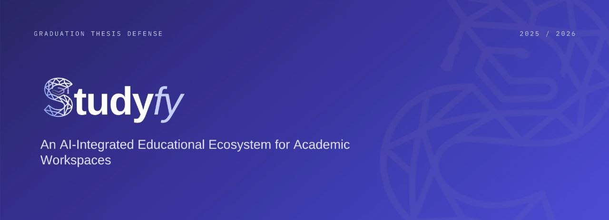
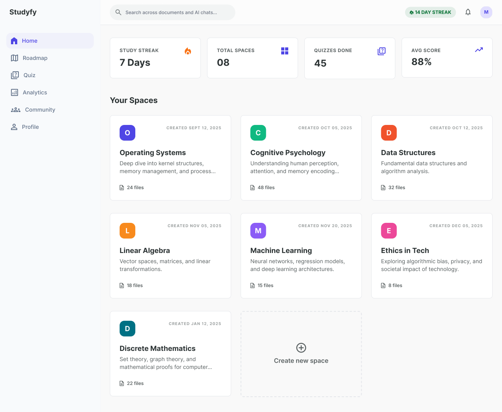
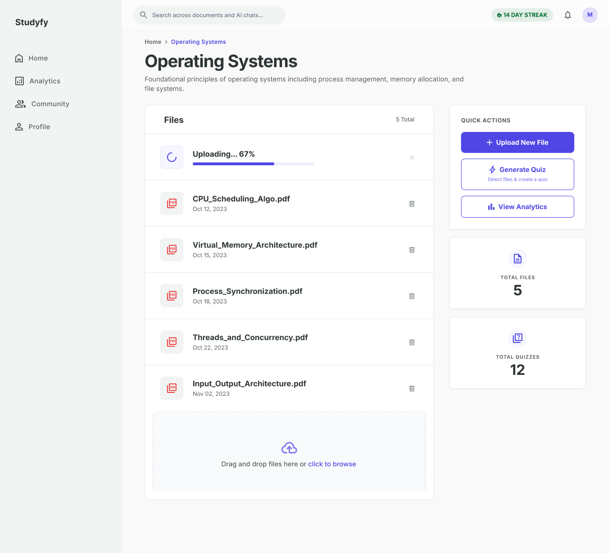
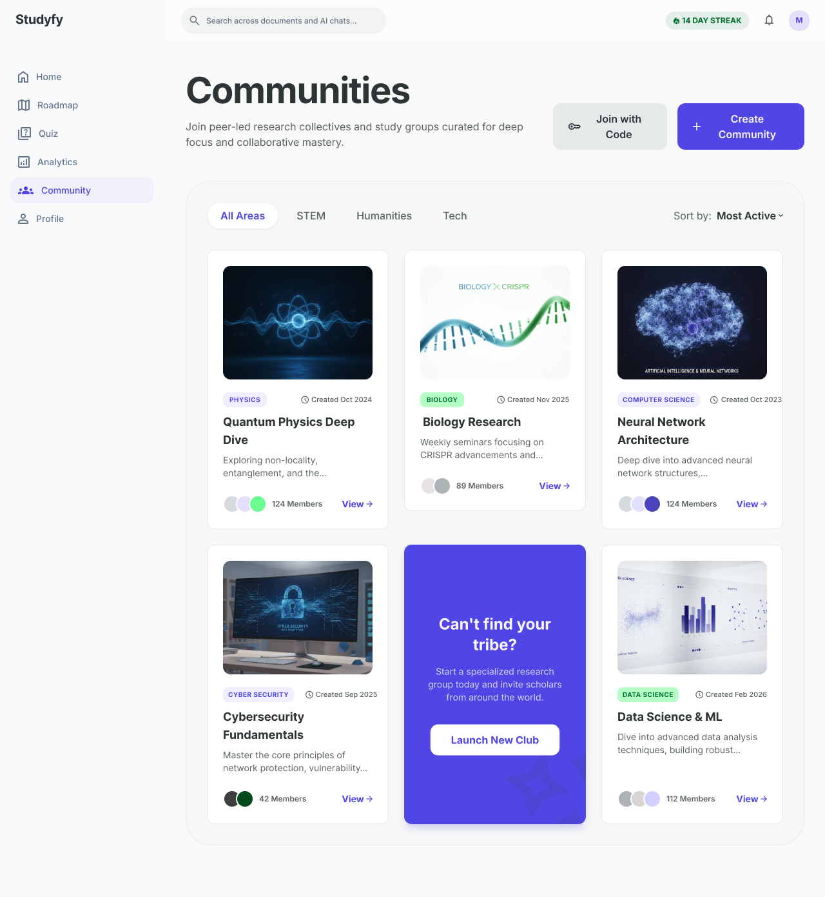
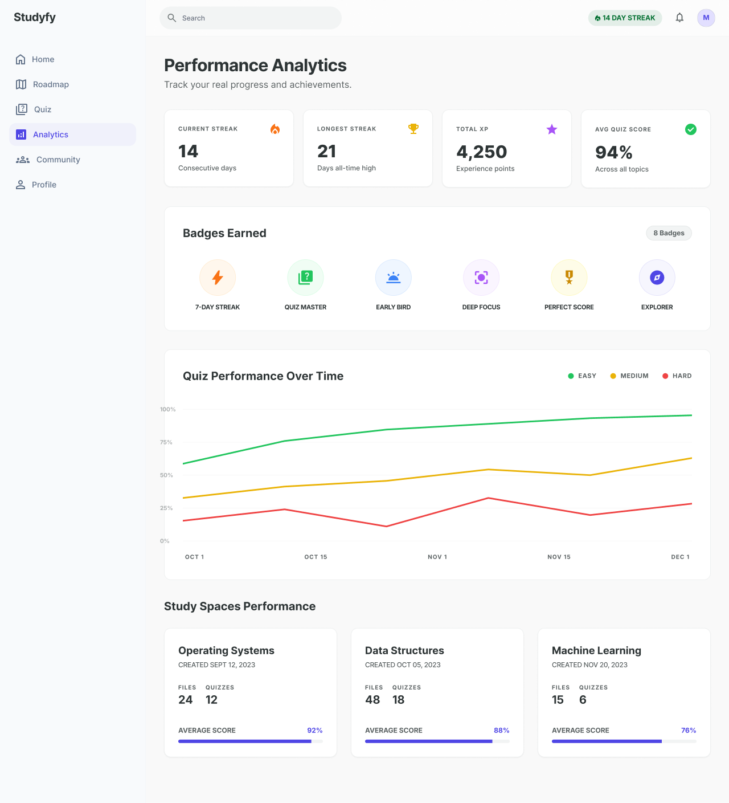
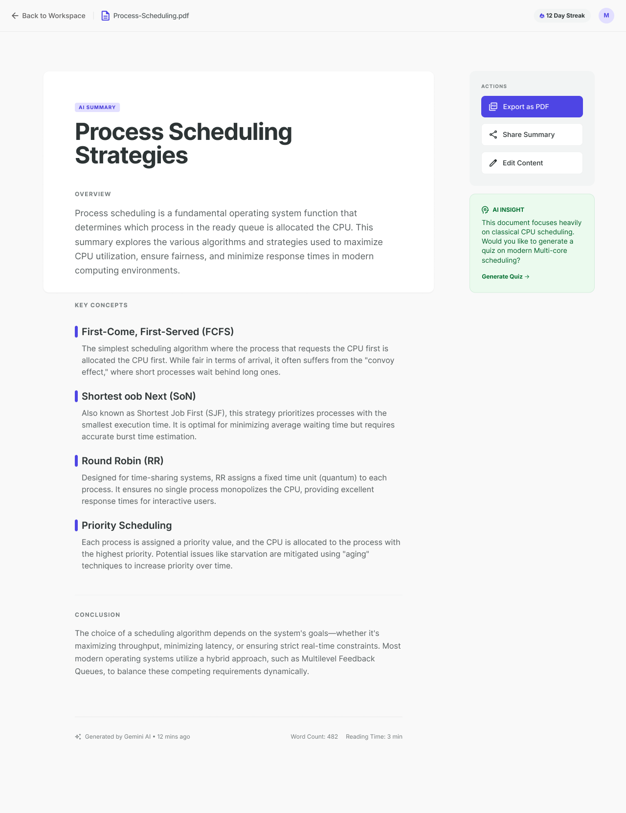

<div align="center">


<br/><br/>

### An AI-Integrated Educational Ecosystem for Academic Workspaces

*Empowering students with intelligent workspace organization, AI-powered study tools, and synchronized group libraries.*

<br/>

[](https://angular.dev)
[](https://typescriptlang.org)
[](https://tailwindcss.com)
[](https://figma.com)
[](https://azure.microsoft.com)
[](https://deepmind.google/technologies/gemini/)
[](https://dotnet.microsoft.com)

<br/>


<br/><br/>



</div>

---

## Overview

**StudyFy** is a high-performance, responsive Single Page Application designed to serve as an intelligent study companion. It solves the fragmentation of student study workflows by unifying AI-powered reading assistants, custom quiz generation, collaborative study communities, personalized learning roadmaps, and comprehensive performance analytics — all in one platform.

---

## Features

<table width="100%">
  <tr>
    <td width="50%" valign="top">
      <h3>
        
        &nbsp;Smart AI Workspace
      </h3>
      <p>Upload lecture notes and generate multi-file summaries or run context-aware chat sessions side-by-side with your PDF viewer. Powered by Gemini AI.</p>
    </td>
    <td width="50%" valign="top">
      <h3>
        
        &nbsp;Custom Quiz Engine
      </h3>
      <p>Instantly generate quizzes from your uploaded files. Features tag-based weak-point tracking, difficulty customization, and direct-to-backend mastery logging.</p>
    </td>
  </tr>
  <tr>
    <td width="50%" valign="top">
      <h3>
        
        &nbsp;Learning Roadmaps
      </h3>
      <p>Generate step-by-step learning plans for complex topics. Track your completion progress with state synchronized across sessions and devices.</p>
    </td>
    <td width="50%" valign="top">
      <h3>
        
        &nbsp;Collaborative Communities
      </h3>
      <p>Create or join academic study rooms. Upload shared files, start discussion threads, and collaborate with classmates in real time.</p>
    </td>
  </tr>
  <tr>
    <td width="50%" valign="top">
      <h3>
        
        &nbsp;Performance Analytics
      </h3>
      <p>Visualize your progress through detailed metrics: daily streaks, XP goals, quiz success ratios, badge achievements, and consistency scorecards.</p>
    </td>
    <td width="50%" valign="top">
      <h3>
        
        &nbsp;Inline PDF Workspace
      </h3>
      <p>Render PDFs natively in the browser with full page navigation and AI-assisted contextual parsing on the active page.</p>
    </td>
  </tr>
</table>

---

## Screenshots

<div align="center">

<table width="100%">
  <tr>
    <td width="50%" align="center">
      
      <br/>
      <sub><b>Dashboard</b> — spaces overview</sub>
    </td>
    <td width="50%" align="center">
      
      <br/>
      <sub><b>AI Workspace</b> — PDF viewer with context-aware chat</sub>
    </td>
  </tr>
  <tr>
    <td width="50%" align="center">
      
      <br/>
      <sub><b>Quiz Engine</b> — AI-generated questions</sub>
    </td>
    <td width="50%" align="center">
      
      <br/>
      <sub><b>Learning Roadmap</b> — upload your study material into a space</sub>
    </td>
  </tr>
  <tr>
    <td width="50%" align="center">
      
      <br/>
      <sub><b>Community</b> — group study rooms</sub>
    </td>
    <td width="50%" align="center">
      
      <br/>
      <sub><b>Analytics</b> — streaks, XP, and mastery breakdown</sub>
    </td>
  </tr>
  <tr>
    <td width="50%" align="center" colspan="2">
      
      <br/>
      <sub><b>AI Summary</b> — lecture summarization</sub>
    </td>
  </tr>
</table>

</div>

---

## Architecture — Direct-to-Azure Upload Flow

StudyFy uses a **Direct-to-Cloud** file architecture via Shared Access Signatures (SAS) to handle large academic files efficiently without overloading the backend:

```
┌─────────────────┐          ┌──────────────────┐          ┌─────────────────┐
│  StudyFy Client │─(1)SAS──▶│  Backend (.NET)  │          │  Azure Blob     │
│   (Angular 20)  │◀─(2)URL──│   REST API       │          │  Storage        │
└─────────────────┘          └──────────────────┘          └─────────────────┘
        │                                                           ▲
        └───────────────── (3) Direct PUT Upload ───────────────────┘
```

**1. SAS Handshake** — Client requests a short-lived upload token from the backend
**2. Direct Upload** — File streams directly to Azure Blob, bypassing backend load
**3. Registration** — Client registers the file ID with the API to index it for Gemini AI

---

## Tech Stack

| Layer | Technology |
|---|---|
| Framework | Angular 20 (Standalone Components) |
| Language | TypeScript 5.9 |
| Styling | Tailwind CSS 3.4 |
| Design | Figma |
| AI Integration | Google Gemini API |
| File Storage | Azure Blob Storage (Direct SAS Upload) |
| Authentication | JWT Bearer Tokens + Google OAuth 2.0 |
| Backend | ASP.NET Core REST API |
| Reactive Layer | RxJS + Angular Signals |

---

## Project Structure

```
src/
├── app/
│   ├── components/        # Shared UI components (Navbar, modals, loaders)
│   ├── guards/            # Route protection (AuthGuard)
│   ├── interceptors/      # HTTP interceptors (automatic JWT injection)
│   ├── models/            # TypeScript interfaces (AI, Auth, Space, Community)
│   ├── services/
│   │   ├── ai.service.ts           # Gemini AI (summaries, quizzes, flashcards)
│   │   ├── auth.service.ts         # Authentication & Google OAuth
│   │   ├── space.service.ts        # Workspace CRUD operations
│   │   ├── storage.service.ts      # Azure SAS tokens & direct upload
│   │   ├── community.service.ts    # Communities, posts, replies, files
│   │   ├── analytics.service.ts    # Progress tracking & badge system
│   │   └── chat.service.ts         # AI chat session management
│   └── pages/
│       ├── auth/           # Login, signup, OTP, password recovery
│       ├── dashboard/      # Spaces overview and recent activity
│       ├── workspace/      # Core study area — PDF viewer + AI chat
│       ├── roadmap/        # AI-generated learning roadmaps
│       ├── communities/    # Group study rooms and shared files
│       ├── analytics/      # Progress charts and achievements
│       ├── profile/        # User profile and statistics
│       └── settings/       # Account preferences
├── environments/           # Dev and production API configuration
└── proxy.conf.json         # CORS proxy for local development
```

---

## Getting Started

### Prerequisites

- Node.js v18+
- npm v9+
- Angular CLI

```bash
npm install -g @angular/cli
```

### Installation

```bash
# Clone the repository
git clone https://github.com/Naeemx7/StudyFy-Website.git
cd StudyFy-Website

# Install dependencies
npm install

# Start the development server
npm start
```

The app will be available at `http://localhost:4200` with the API proxy active.

### Environment Configuration

Open `src/environments/environment.ts` and configure your API base URL:

```typescript
export const environment = {
  production: false,
  apiUrl: '/api',
  googleClientId: 'YOUR_GOOGLE_CLIENT_ID'
};
```

---

## Frontend Team

<br/>

<table align="center" border="0">
  <tr>
    <td align="center" width="260">
      <a href="https://github.com/Naeemx7">
        
        <br/><br/>
        <strong>Mohammed Naeem Shousha</strong>
      </a>
      <br/>
      <sub>Frontend Developer &nbsp;·&nbsp; Product Designer</sub>
      <br/><br/>
      <a href="https://github.com/Naeemx7">
        
      </a>
    </td>
    <td width="80"></td>
    <td align="center" width="260">
      <a href="https://github.com/SAKR102">
        
        <br/><br/>
        <strong>Youssef Hany Sakr</strong>
      </a>
      <br/>
      <sub>Frontend Developer</sub>
      <br/><br/>
      <a href="https://github.com/SAKR102">
        
      </a>
    </td>
  </tr>
</table>

<br/>

---

<h2 align="center">Institution</h2>

<br/>

<div align="center">


### Suez Canal University

Faculty of Computers & Informatics<br/>
Department of Computer Science

<sub>Class of 2026</sub>

</div>

<br/>

---

## License

All rights reserved. This project was built as a graduation project for academic purposes at Suez Canal University. The source code may not be copied, redistributed, or reused without explicit permission from the authors.

---

<div align="center">
  <sub>Coded, caffeinated, and barely on time. &nbsp;·&nbsp; StudyFy © 2026</sub>
</div>
